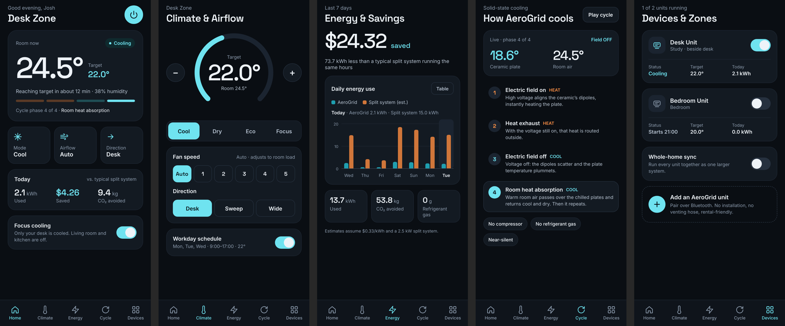

# AeroGrid

The control centre app for **AeroGrid**, a solid-state, non-compression air conditioner built on a hybrid electrocaloric / magnetocaloric system. No compressor, no refrigerant gas, near-silent.

The app lets you adjust temperature and airflow, track energy use and savings against a traditional split system, see how the four-phase cooling cycle works, and manage multiple units as zones.

## Screens

| Tab | What it does |
|---|---|
| **Home** | Room vs target temperature, live cycle phase, quick controls, today's energy and savings, Focus cooling (desk zone only) |
| **Climate** | Target temperature dial, modes (Cool / Dry / Eco / Focus), fan speed, airflow direction, workday schedule |
| **Energy** | 7-day usage chart (AeroGrid vs split-system estimate), savings, CO₂ avoided, table view |
| **Cycle** | The four phases explained, with a live, animated phase readout |
| **Devices** | Units and zones, on/off per unit, whole-home sync, add a unit |



Designs live in [`design/`](design/) (Claude Design artboards, one `.dc.html` per screen).

## Tech stack

- [Expo](https://expo.dev) SDK 58 + React Native, TypeScript
- [Expo Router](https://docs.expo.dev/router/introduction/) (file-based tab navigation in `app/`)

## Run it

```bash
npm install
npx expo start
```

Scan the QR code with the **Expo Go** app on your phone (iOS or Android), or press `w` to open it in a browser.

## Project structure

```
app/          screens and navigation (Expo Router)
components/   shared UI components
constants/    theme colours, fonts and radii
lib/          app state, cooling-cycle phases and energy demo data
assets/       icons, splash, fonts
design/       screen designs
```

## Data note

Energy and savings figures in the app are demo data. They assume $0.33/kWh, a 2.5 kW split system for comparison, and Queensland grid emissions. Swap in real AeroGrid efficiency figures once they are measured.
